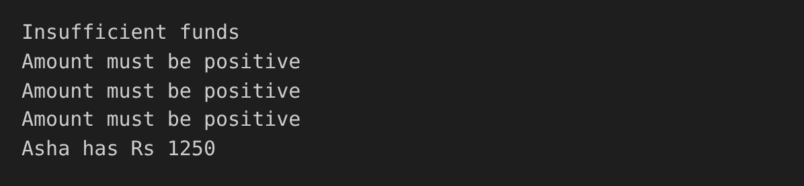

# Bank Account System

My first Python class: a `BankAccount` that keeps a balance, takes deposits and withdrawals, and refuses invalid amounts with a clear error message. The demo opens an account for Asha, deposits Rs 1500, withdraws Rs 250, then tries four invalid operations.



## How to run it

You need Python 3. In PowerShell or cmd:
```
git clone https://github.com/bhargavsaideekonda/bank.git
cd bank
python bank2.py
```

## What I built myself

- A `BankAccount` class with `__init__` (a name and a starting balance of 0), `deposit()`, `withdraw()` and `report()`.
- Checks that `raise ValueError`: "Amount must be positive" for zero or negative amounts, and "Insufficient funds" when you withdraw more than the balance.
- `try`/`except ValueError as e` blocks that catch each error and print its message, so one bad operation doesn't stop the program.

I built this with step-by-step help from Claude, an AI tutor. I typed and ran every line myself.
